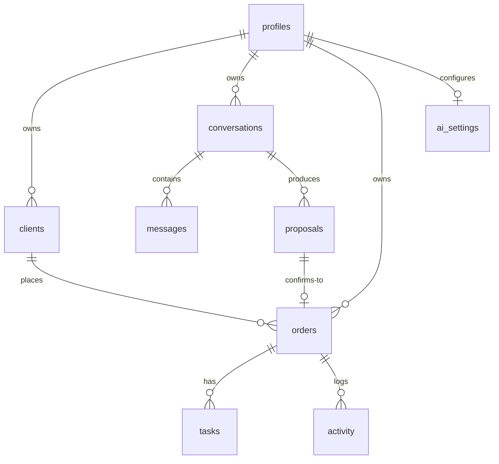

# Database

Source of truth for production: `supabase/migrations/0001_init.sql`.
The local dev store mirrors this shape (see `lib/repo.local.ts`).

## 1. Schema

**profiles** — `user_id PK (auth.users.id)`, `display_name`, `timezone`
(IANA string), `default_currency` (ISO-4217), timestamps.

**clients** — `id uuid PK`, `user_id`, `name`, `contact nullable`,
`notes nullable`, timestamps. Index `(user_id, lower(name))` for search.
No uniqueness on name: duplicates are resolved by the user, never auto-merged.

**conversations** — `id uuid PK`, `user_id`, `title` (auto from first message),
`status` (`open | confirmed`), timestamps. Index `(user_id, updated_at desc)`.

**messages** — `id uuid PK`, `conversation_id FK`, `user_id`, `role`
(`user | assistant | system`), `content` (capped at 12k chars), timestamps.
Index `(conversation_id, created_at)`.

**proposals** — `id uuid PK`, `conversation_id FK`, `user_id`,
`payload JSONB` (validated proposal, see `docs/AI_WORKFLOW.md`),
`status` (`draft | ready | confirmed | superseded`), `idempotency_key uuid`
default random, timestamps. **Unique `(user_id, idempotency_key)`.**

**orders** — `id uuid PK`, `user_id`, `client_id FK nullable → clients`,
`conversation_id FK nullable`, `proposal_id FK nullable`,
`idempotency_key uuid nullable`, `title`, `description nullable`,
`deliverables text[]`, `requirements text[]`, `deadline_date date nullable`
(date-only stays date-only), `deadline_text nullable` (original wording, e.g.
“next Friday”), `timezone`, `budget_amount numeric nullable`,
`budget_currency char(3) nullable`, `status`
(`draft|ready|in_progress|delivered|completed|cancelled`), timestamps.
**Unique `(user_id, idempotency_key)`** where key not null — the duplicate-
confirmation guard. Indexes `(user_id, status)`, `(user_id, deadline_date)`.

**tasks** — `id uuid PK`, `order_id FK`, `user_id` (denormalized for RLS +
ownership checks), `title`, `is_client_requirement bool` (explicit requirement
vs AI-suggested — shown separately), `status` (`todo|in_progress|done`),
`position int`, timestamps. Index `(order_id, position)`.

**activity** — `id uuid PK`, `order_id FK`, `user_id`, `kind`
(`created|status_changed|edited|task_added|task_updated|confirmed`), `detail`
short human text (no secrets), timestamps. Index `(order_id, created_at desc)`.

**ai_settings** — `user_id PK`, `provider` (`openai_compatible | offline`),
`model`, `key_ciphertext` (AES-GCM, never returned), `key_hint` (last 4),
timestamps.

## 2. Tables vs JSON

Separate tables for clients/orders/tasks/activity/messages because they are
queried independently (lists, filters, RLS per row, FK integrity, aggregation).
JSONB only for the **proposal payload**: it is an AI draft with a variable shape
validated by Zod at the boundary, snapshotted per conversation turn — shredding
every draft revision into relational rows would add churn with no query benefit.
Once confirmed, the proposal is shredded into `orders` + `tasks` rows.

## 3. Ownership & RLS

Every user-owned table has `user_id` + policies:
`USING (auth.uid() = user_id)` for SELECT/UPDATE/DELETE and
`WITH CHECK (auth.uid() = user_id)` for INSERT. `profiles.user_id` references
`auth.users(id)`; new profiles are created via trigger on signup
(`handle_new_user()`), users cannot insert their own row.
Server code **also** checks ownership (defense in depth + the local backend has
no RLS). Cross-resource writes verify the referenced row belongs to the caller
(e.g. `client_id` lookup scoped by `user_id`) before writing.

## 4. Atomic confirmation

Supabase: `rpc confirm_intake(...)` SECURITY DEFINER function inserts order +
tasks, marks proposal confirmed, writes activity in one transaction; the unique
`(user_id, idempotency_key)` constraint makes retries return the existing row.
Local backend: single synchronous write batch under one file lock-equivalent
(await chain + atomic rename). See `docs/API.md`.
