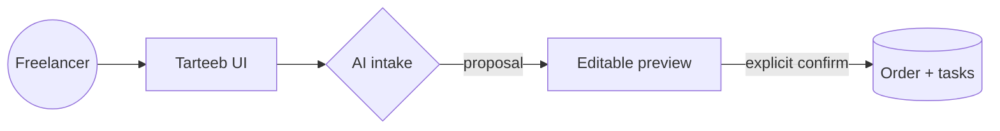

# User flows

## 0. Legend

## 1. Onboarding

1. Visit `/` unauthenticated → redirected to `/login`.
2. Sign up (`/signup`): email + password + display name → profile created with
   defaults (timezone guessed from browser, currency EGP|USD… default EGP).
3. Lands on Home with empty state: short explanation + 3 realistic example prompts
   (EN landing page, AR logo request, mixed-language edit round) → click fills composer.
4. Optional: Settings → AI → paste key → Test connection → Save.

## 2. Intake — happy path (complete request)

1. Home: paste “Ahmed wants a landing page for his gym, 5 sections, delivery next
   Friday, budget 8000 EGP” → Send.
2. Composer shows processing state; input preserved.
3. Assistant message: structured summary + resolved date (“Friday 17 Oct 2026”)
   + editable **order preview** (title, deliverables, requirements, deadline,
   budget, suggested tasks, client suggestion).
4. User edits inline, picks/confirms client, presses **Create order**.
5. Button disables while pending; success → inline success state + link “Open order”.
6. Further messages in that conversation do NOT modify the order (banner says so).

## 3. Intake — clarification (incomplete request)

1. Paste “Ahmed wants a landing page for his gym next Friday.” (no scope/price).
2. Assistant replies with interpretation (“landing page” = one-page marketing site;
   “next Friday” = Fri 17 Oct 2026 in Africa/Cairo) + up to 3 focused questions:
   page sections/content source, and confirmation of the resolved date.
3. User answers conversationally (“5 sections: hero, classes, trainers, pricing,
   contact; content from him Thursday”) or marks price “Decide later”.
4. Proposal updates; unknowns stay “Unknown” — never invented.
5. Review → confirm as in flow 2.

## 4. Intake — failure paths

- **No AI key + offline assistant off?** Never happens: offline assistant always
  available and labelled; real-model errors show message + Retry (input preserved).
- **Provider timeout/rate-limit:** assistant message shows what failed + Retry button.
- **Malformed AI output:** rejected by Zod; user sees “couldn't structure that” +
  Retry; nothing written to DB.
- **Oversized input:** composer enforces `AI_MAX_INPUT_CHARS`; server re-validates
  with a clear error.

## 5. Manual creation

Orders → New order: title (required), client (select or inline-create), description,
deliverables, requirements, deadline (date-only), budget + currency, tasks added
one by one. Saves as Draft. No AI involved.

## 6. Order management

Order detail: edit fields (per-transition rules), change status via explicit control
(Draft→Ready→In progress→Delivered→Completed; Cancelled from any non-terminal),
check off tasks (To do→In progress→Done), view intake excerpt + activity log.
Progress bar = done/total. Overdue badge when deadline < today and not
Delivered/Completed/Cancelled.

## 7. Clients

Clients → New: name (required), contact (optional), notes. Detail shows related
orders. During intake, AI-suggested client appears as “suggested: Ahmed (new)” with
[Use existing ▾] / [Create “Ahmed”] — never auto-created.

## Public signup and mobile session management

With Supabase email confirmation enabled, signup shows an inbox confirmation
notice; the token-hash link establishes a server session. Invalid links return to
login with feedback. Mobile and desktop both offer sign-out. Refined proposal
revisions refresh the editable preview. Network failures restore send/confirm
controls and preserve the confirmation key.
